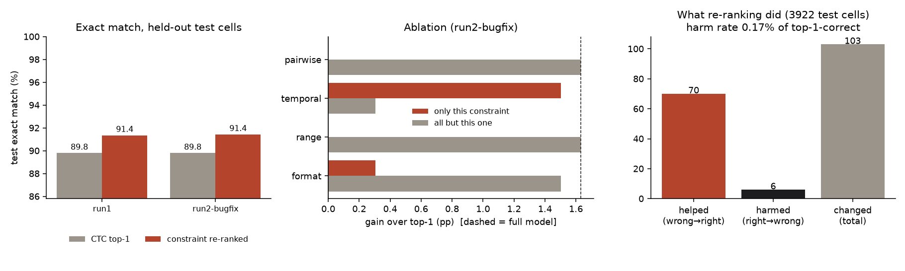
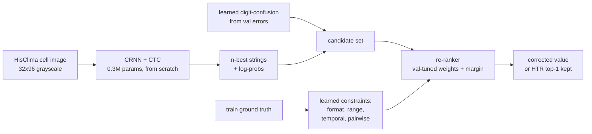

# LogbookQC

**A constraint-based QC and re-ranking layer for handwritten numeric cells in historical ship weather logs.**
On 3,922 held-out cells it lifts exact match from **89.80% to 91.43% (+1.63 pp)** while wrongly changing
**0.17%** of cells the recogniser had right. The gain comes almost entirely from temporal continuity
(+1.50 pp alone); the cross-field "physics" rules contribute nothing measurable. Verdict: **CONFIRMED**
against the pre-registered rule, small effect, honestly attributed - see [EVAL-FINDINGS.md](EVAL-FINDINGS.md).

This is a reproducible re-ranker built on a known idea, not a new method (see [Reference](#reference)).
It is a portfolio piece: climate-data-rescue groups are the only users and they do not buy tools.



*Generated by `src/make_figures.py` from the committed `eval_results.json`; left: every run, middle: per-constraint
ablation, right: cells helped vs harmed.*

## What it does



- **Recogniser** (`src/htr.py`, `src/train.py`): small CRNN+CTC trained from scratch on the 14.3k train-split
  numeric cells, CTC prefix beam search for the n-best.
- **QC layer** (`src/qc.py`): learns, from train ground truth only, a per-column digit-format prior, a
  per-column value-range prior, a Laplace model of the change between consecutive same-column cells, and
  column pairs with a stable ordering (>=97% of train rows). Nothing about 1880s units is hard-coded.
  Single-digit confusion variants of the top-1 (learned from the recogniser's own val mistakes) are added as
  candidates. Weights and a change-margin are picked on the val split.
- **Column identity** (`src/cells.py`): table width W is recovered from printed hour labels (consecutive hours
  sit W cells apart); column = `cell_index mod W` (vol003 W=16; Albatross 16-20).

## 30-second demo (no download, no API key)

```bash
pip install -r requirements.txt
python demo.py          # re-ranks the committed n-best on the test pages, prints real corrections + failures
python -m pytest -q tests
```

Output is the real before/after table: for example a cell read `3.56` in a barometer column whose neighbours
read `30.52` and `30.36` is corrected to the true `30.56`; a true `83` is wrongly pulled to `80` next to a `78`.

## Reproduce from scratch

```bash
curl -L -o raw/HisClima.tar.gz https://zenodo.org/records/7442971/files/HisClima.tar.gz   # 2.3 GB, CC BY 4.0
python src/fetch_text.py && python src/build_meta.py     # lists, transcriptions, layout widths
python src/extract_images.py                             # streams the tar once, keeps 19.8k numeric cells
python src/train.py                                      # ~27 min on 4 CPU threads, ~250 MB RAM
python src/decode.py && python src/run_eval.py --label myrun
python src/make_figures.py
```

`eval_results.json` is append-only: run1 is the first, as-pre-registered result; run2 is a bug-fix re-run.

## Results (test split, 3,922 cells, 60 unseen pages)

| | top-1 | re-ranked |
|---|---|---|
| exact match | 89.80% | 91.43% |
| character error rate | 4.46% | 3.83% |
| impossible values (unparsable / out of train range / unseen format) | 2.50% | 1.78% |
| cells helped / harmed | | 70 / 6 |

Pre-registered pass rule: gain >= 1.0 pp and harm < 2% of correct cells. Passed on run1 (+1.56 pp, 0.26%)
and run2 (+1.63 pp, 0.17%).

Honest limits: +1.6 pp on a strong baseline; truth is in the candidate set 98.0% of the time, so most of the
headroom is not captured; decimal-temperature cells (`dd.d`) stay at ~55%; p-values treat cells as independent
(they are not); page-level bootstrap not run.

## What was cut
Table detection (HisClima ships pre-cut cells), the reanalysis/20CR reference-field stage, ditto-mark
(`"`) resolution, non-numeric fields, GPU training, TrOCR baseline. Full-page processing is not built.

## Reference

This build reproduces/extends an idea, not a single paper's code.

- **Dataset**: *HisClima Dataset* - PRHLT research center (creator as listed on Zenodo), DOI
  [10.5281/zenodo.7442971](https://doi.org/10.5281/zenodo.7442971), CC BY 4.0 (v1 record 4106886).
- **Closest prior idea**: EGU26-2509 (2026 conference abstract, found during validation, title/authors not
  re-verified for this repo): multimodal-LLM transcription of weather logs filtered by physical relationships
  between meteorological variables. Also MeteoSaver (generic temperature QC) and Southampton's TrOCR-ctx /
  ByT5 correction work.
- **What was reproduced / where this differs**: the *idea* of validating transcriptions with physical-variable
  constraints. This build adds (a) constraints applied as an n-best **re-ranker that corrects**, not only
  filters, (b) a **learned digit-confusion** candidate generator, (c) a measured **harm rate** and ablation on
  an open dataset, fully reproducible. The measured delta worth stating: on this data the *temporal*
  constraint carries essentially all the gain and learned cross-variable ordering adds nothing over a decent
  recogniser.
